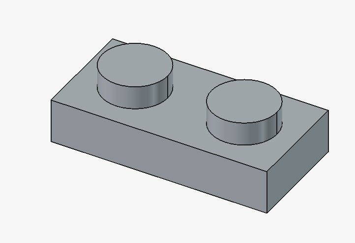
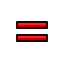

# Урок 2. Пластинка 1×2

**Що навчимося:** будувати коло з центром на осі, ставити обмеження рівності, симетрії та розмірності, а також знаходити й видаляти зайві обмеження.

## Відео

  <iframe src="https://www.youtube.com/embed/LoHtNpbouKA" allowfullscreen></iframe>

## Кроки

### 1. Ескіз

1. Відкрийте FreeCAD і під час створення нового файлу виберіть **Параметричне тіло** (Parametric Body).
2. Натисніть **Новий ескіз** і виберіть площину **XY**.
3. Виберіть інструмент **Центральний прямокутник**, клацніть у **точці початку координат** і намалюйте прямокутник: ширина **15,8 мм**, довжина **7,8 мм**.
4. Виберіть інструмент **Коло** (за центром) і клацніть **на червоній осі X**, щоб центр кола лежав на ній. Задайте **діаметр 4,8 мм**.

   > 💡 **Перевірка:** спробуйте потягнути центр кола мишкою. Якщо він рухається лише вздовж червоної осі, ви все зробили правильно.

5. Правіше намалюйте друге коло будь-якого розміру, теж з центром на осі X.
6. Затисніть **Ctrl**, виділіть контури обох кіл і застосуйте обмеження **рівності**.
7. Затисніть **Ctrl**, виділіть центри обох кіл і **зелену вісь Y**, потім застосуйте обмеження **симетрії**.

   > ⚠️ **Увага:** тут FreeCAD може повідомити про зайве (надлишкове) обмеження. Подивіться його номер у повідомленні, знайдіть обмеження з цим номером у списку обмежень, клацніть по ньому **правою кнопкою миші** й видаліть.

8. Виберіть інструмент **Розмірність**, виділіть центри обох кіл і задайте відстань між ними **8 мм**.
9. Вийдіть з ескізу кнопкою **Leave Sketch**.

### 2. Основа пластинки

10. Клацніть у будь-якому порожньому місці робочої області, щоб ескіз став чорним.
11. Затисніть **Ctrl** і виділіть **чотири сторони прямокутника**.
12. Виберіть **Видавлювання** (Pad), задайте довжину **3,2 мм** і поставте галочку **«Зворотний»**. Натисніть **ОК**.

### 3. Шипи

13. У лівій панелі розкрийте видавлювання (**Pad**), виберіть ескіз (**Sketch**) і зробіть його видимим (клавіша **Пробіл**).
14. Затисніть **Ctrl** і виділіть **обидва кола**.
15. Виберіть **Видавлювання** і задайте довжину **1,7 мм**. Натисніть **ОК**.
16. Збережіть файл: **Файл → Зберегти як…**

**Завдання.** Змоделюйте пластинку 1×2 і збережіть файл з назвою 
`Пластинка 1x2 Прізвище Клас.FCStd`  
📤 **Надішліть файл з роботою в Google Classroom.**

