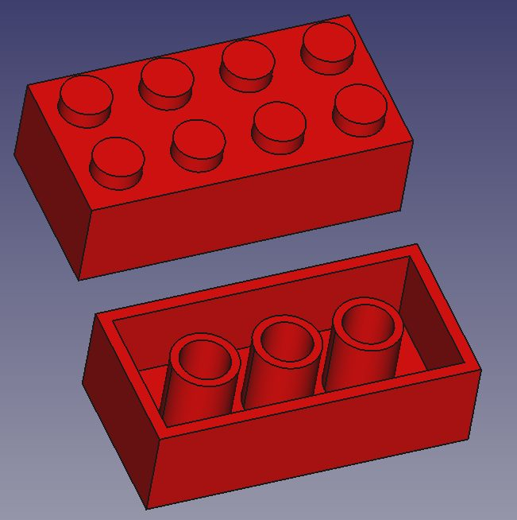
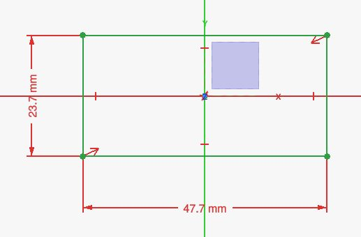
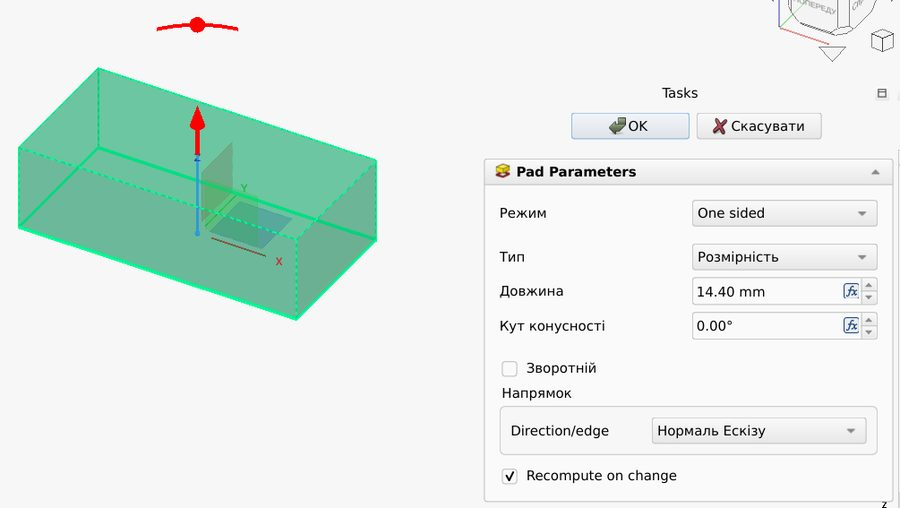
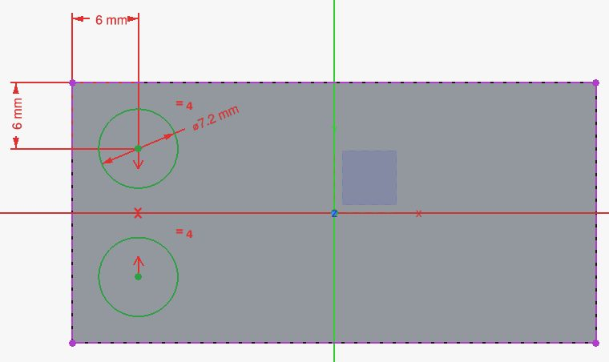
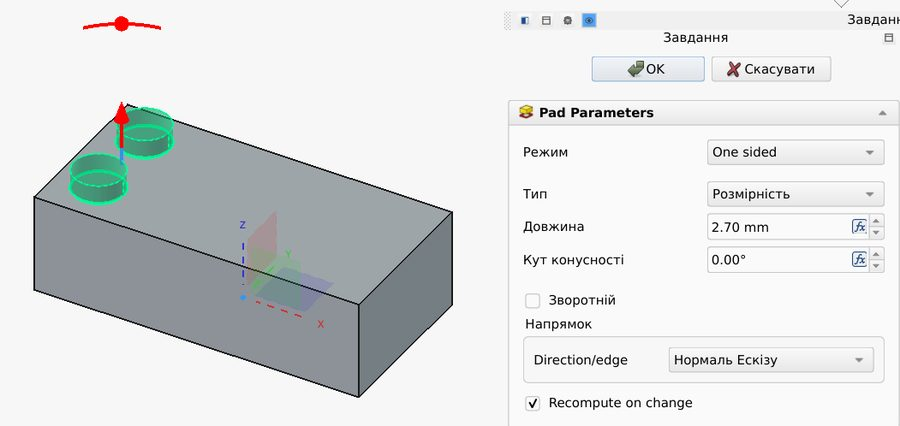
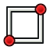
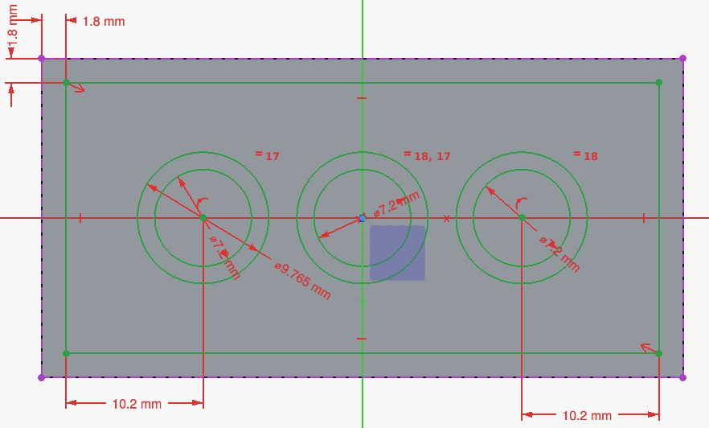
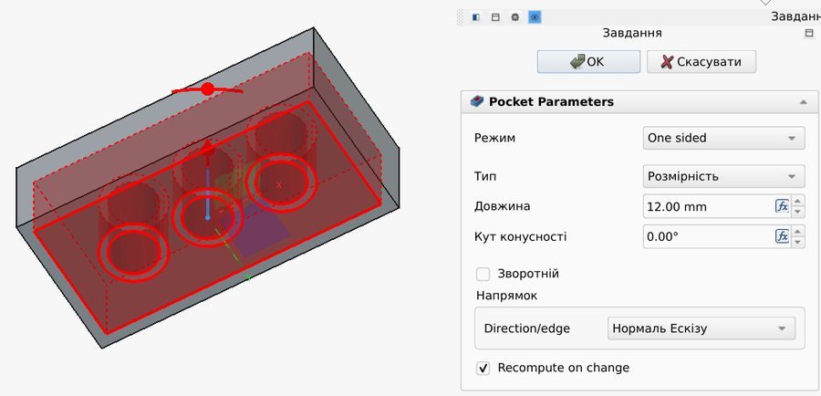
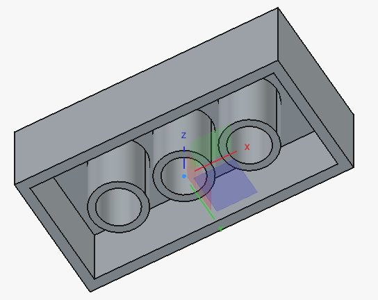
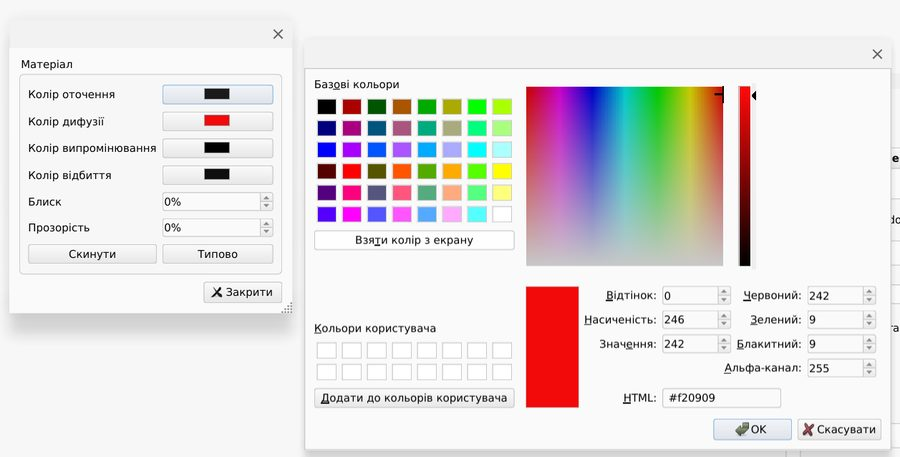

# Урок 3. Блок 2×4

**Завдання.** Спроєктуйте у FreeCAD деталь LEGO 2×4.

**Що навчимося:** будувати центральний прямокутник, прив'язувати ескіз до країв грані через **зовнішню геометрію**, ставити обмеження **рівності** і **симетрії**, робити **лінійний масив** і **виріз**, налаштовувати матеріал і колір.

## Відео

  <iframe src="https://www.youtube.com/embed/t6yTvfP7Ums" allowfullscreen></iframe>

## Хід роботи

### 1. Основа

1. Відкрийте FreeCAD і під час створення нового файлу виберіть **Parametric Body**.
2. Натисніть **Новий ескіз** (New Sketch) і виберіть площину **XY**. Ескіз відкриється в режимі редагування, і ви дивитиметеся на нього згори.
3. Виберіть інструмент **Центральний прямокутник** (Centered Rectangle) і клацніть у точці початку координат.
4. Введіть з клавіатури розміри: ширина **47,7 мм**, довжина **23,7 мм**.

   

5. Вийдіть з ескізу кнопкою **Leave Sketch**.
6. Видавіть ескіз інструментом **Видавлювання** (Pad) на **14,4 мм**. Інші параметри залишіть як є й натисніть **ОК**.

   

### 2. Шипи зверху

7. Виділіть **верхню грань** блока й натисніть **Новий ескіз**.
8. Намалюйте одне коло інструментом **Circle** у будь-якому місці.
9. Кола треба розташувати відносно країв грані, тому скористаємося інструментом **Зовнішня геометрія** (External geometry). Він дає змогу посилатися на ребра грані й точно прив'язувати до них кола:
   - спочатку клацніть кнопку **Режим допоміжних ліній** (Toggle construction geometry), щоб лінії стали пунктирними;
   - виберіть інструмент **Зовнішня геометрія** і клацніть по прямокутнику (краях грані);
   - знову клацніть кнопку **Режим допоміжних ліній**, щоб вимкнути його.
10. Інструментом **Розмірність** задайте відстань **6 мм** від центра кола до лівого ребра. Так само задайте 6 мм до верхнього ребра.
11. Задайте **діаметр кола 7,2 мм**.
12. Намалюйте друге коло.
13. Затисніть **Ctrl**, виберіть обидва кола і застосуйте обмеження **рівності**.
14. Затисніть **Ctrl**, виберіть центри обох кіл і вісь X (червону лінію), потім застосуйте обмеження **симетрії**.

    

15. Вийдіть з ескізу (**Leave Sketch**) і видавіть його (**Pad**) на **2,7 мм**.

    

16. Виділіть щойно створене видавлювання (**Pad001**) і натисніть **Лінійний масив**. Напрямок: **горизонтальна вісь ескізу**, довжина **36 мм** (проміжок, у який мають уміститися копії), кількість **4**. Натисніть **ОК**.

    

### 3. Виріз знизу з трубками

17. Поверніть модель, виділіть **нижню грань** блока й натисніть **Новий ескіз**.
18. Прив'яжіть ескіз до країв грані так само, як у кроці 9:
    - клацніть кнопку **Режим допоміжних ліній**;
    - виберіть **Зовнішня геометрія** і клацніть по прямокутнику;
    - знову клацніть кнопку **Режим допоміжних ліній**.
19. Намалюйте довільний **прямокутник**. Інструментом **Розмірність** задайте відстань **1,8 мм** від верхнього лівого кута прямокутника до лівого ребра і так само до верхнього ребра.
20. Затисніть **Ctrl**, виберіть верхній лівий кут прямокутника, нижній правий кут і точку початку координат, потім застосуйте **симетрію**.
21. Намалюйте коло з центром **на осі X** (червона лінія) і діаметром **9,765 мм**. Задайте відстань від його центра до лівого ребра прямокутника: **10,2 мм**.
22. Намалюйте ще два кола: одне з центром у початку координат, друге з центром на осі X. Діаметри можуть бути довільні.
23. Затисніть **Ctrl**, виберіть усі три кола й застосуйте **рівність**.
24. Задайте відстань від центра правого кола до правого ребра прямокутника: **10,2 мм**.
25. Намалюйте ще три кола **діаметром 7,2 мм** зі спільними центрами з трьома попередніми колами.

    

26. Вийдіть з ескізу, виберіть його й застосуйте **Виріз** (Pocket) глибиною **12 мм**. Натисніть **ОК**.

    

    

### 4. Матеріал і колір

27. Виберіть **Тіло** в лівій панелі, перейдіть на вкладку **Перегляд** і натисніть **Appearance**.
28. Виберіть матеріал **Plastic**.
29. Ще раз натисніть **Appearance**, виберіть **Колір дифузії** і задайте колір на свій смак. Натисніть **ОК**.

    

30. Закрийте меню. Модель готова!

    

**Здача.** Збережіть файл з назвою 
`Блок 2x4 Прізвище Клас.FCStd`

