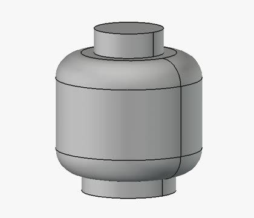

# Проєкт LEGO-чоловічок. Етап 1: Голова

Це перший етап проєкту: моделюємо LEGO-чоловічка частинами, і почнемо з голови.

**Що навчимося:** створювати параметричне тіло, малювати ескізи на гранях, видавлювати (Pad), вирізати (Pocket) і заокруглювати ребра (Fillet).

## Відео

  <iframe src="https://www.youtube.com/embed/fwbixKrFBlA" allowfullscreen></iframe>

## Кроки

> Усі кола будуємо з центром у **точці початку координат**.

**1. Тіло.** У Part Design створіть **параметричне тіло** (Body).

**2. Шия.** Натисніть **Новий ескіз** і виберіть площину **XY**. Побудуйте коло діаметром **6,5 мм** і закрийте ескіз. Інструментом **Видавлювання (Pad)** видавіть коло на **1,2 мм**.

**3. Голова.** Виділіть **верхню грань** циліндра, що вийшов, і створіть на ній новий ескіз. Побудуйте коло діаметром **10,1 мм** і закрийте ескіз. Видавіть його на **8,4 мм**.

**4. Шип.** Виділіть верхню грань голови і створіть новий ескіз. Побудуйте коло діаметром **4,8 мм** і закрийте ескіз. Видавіть його на **1,7 мм**.

**5. Отвір знизу.** Поверніть модель на 180°, щоб побачити низ. Виділіть **нижню грань** і створіть новий ескіз з колом діаметром **4,8 мм**. Закрийте ескіз і зробіть **Виріз (Pocket)** глибиною **6 мм**.

**6. Заокруглення.** Виділіть **верхнє і нижнє ребро** великого циліндра (голови) і застосуйте **Заокруглення (Fillet)** з радіусом **1,75 мм**.

**7. Збереження.** Виберіть **Файл → Зберегти як…**

**Завдання.** Змоделюйте голову LEGO-чоловічка і збережіть файл з назвою 
`Lego Голова Прізвище Клас.FCStd` 
Наприклад: `Lego Голова Петренко 10-А.FCStd`  
📤 **Надішліть файл з роботою в Google Classroom.**

