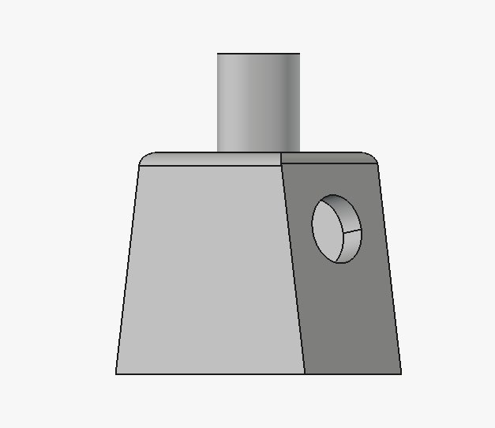

# Проєкт LEGO-чоловічок. Етап 2: Тулуб

Продовжуємо проєкт: після голови моделюємо тулуб LEGO-чоловічка.

**Що навчимося:** малювати фігуру ламаною, робити деталь порожнистою інструментом «Товщина» і вирізати отвори одразу з двох боків.

## Відео

🎬 Відео скоро з'явиться

## Кроки

### 1. Тулуб

1. Відкрийте FreeCAD, виберіть **Параметричне тіло**, потім **Новий ескіз** і площину **XZ**.
2. Інструментом **Ламана** намалюйте трапецію: почніть **на червоній осі X**, низ і верх малюйте рівно горизонтально, останню точку з'єднайте з першою.
3. Затисніть **Ctrl**, виділіть два нижні кути та **зелену вісь** і застосуйте **симетрію**. Так само зробіть для двох верхніх кутів.
4. Задайте розміри: низ **15,44 мм**, верх **11,36 мм**, висота **12,72 мм**. Ескіз має стати зеленим. Вийдіть з ескізу.
5. **Видавлювання** на **7,85 мм** з галочкою **«Симетрично до площини»**.
6. Поверніть модель низом до себе, виділіть **нижню грань** і застосуйте **Товщину** **1,5 мм** з галочкою **«Зробити товщину всередину»**. Тулуб стане порожнистим.

### 2. Шия

7. На **верхній грані** створіть ескіз з **колом** у точці початку координат, діаметр **4,8 мм**.
8. **Видавлювання** на **5,7 мм**.

### 3. Отвори для рук

9. Створіть **Новий ескіз** на площині **YZ**. Намалюйте **коло** з центром **на зеленій осі**, діаметр **4 мм**, висота центра над віссю X **7,23 мм**.
10. **Виріз**: тип **«Через усе»** і галочка **«Симетрично до площини»**. Отвори з'являться одразу з обох боків.

### 4. Заокруглення і здача

11. Виділіть **4 ребра навколо верхньої грані** (плечі) і застосуйте **Заокруглення** **0,75 мм**.
12. Збережіть файл: **Файл → Зберегти як…**
13. 📤 Надішліть файл з роботою в **Google Classroom**.

**Завдання.** Змоделюйте тулуб LEGO-чоловічка і збережіть файл з назвою 
`Lego Тулуб Прізвище Клас.FCStd`  
📤 **Надішліть файл з роботою в Google Classroom.**

