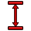

# Проєкт LEGO-чоловічок. Етап 2: Тулуб

Продовжуємо проєкт: після голови моделюємо тулуб LEGO-чоловічка.

**Що навчимося:** малювати фігуру ламаною, повністю визначати ескіз обмеженнями (горизонтальність, точка на об'єкті, симетрія, відстані), робити деталь порожнистою інструментом «Товщина», вирізати отвір «До першої грані» й віддзеркалювати його.

## Відео

🎬 Відео скоро з'явиться

## Кроки

### 1. Ескіз тулуба

1. Відкрийте FreeCAD і під час створення нового файлу виберіть **Параметричне тіло** (Parametric Body).
2. Натисніть **Новий ескіз** і виберіть площину **XZ**.
3. Інструментом **Ламана** (Polyline) намалюйте замкнену фігуру з чотирьох відрізків, схожу на трапецію: знизу ширша, зверху вужча. Останню точку з'єднайте з першою.
4. Виділіть верхню сторону й застосуйте обмеження **горизонтальності**. Так само зробіть з нижньою стороною (якщо FreeCAD не поставив його сам).
5. Затисніть **Ctrl**, виділіть **нижній лівий кут** трапеції та **червону вісь X** і застосуйте **Точку на об'єкті**. Оскільки нижня сторона горизонтальна, увесь низ тулуба ляже на вісь X.
6. Затисніть **Ctrl**, виділіть два нижні кути трапеції та **зелену вісь** і застосуйте **симетрію**. Те саме зробіть для двох верхніх кутів.
7. Інструментом **Горизонтальна відстань** задайте довжину нижньої сторони **15,44 мм**, а верхньої **11,36 мм**.
8. Інструментом **Вертикальна відстань** задайте висоту трапеції **12,72 мм**.

   > 💡 **Перевірка:** ліворуч у «Повідомленнях розв'язувача» має з'явитися напис **«Повністю визначений ескіз»** (Fully constrained sketch), а лінії стануть зеленими. Якщо ні, якогось обмеження бракує.

9. Вийдіть з ескізу кнопкою **Leave Sketch**.

### 2. Об'ємний тулуб

10. Виберіть **Видавлювання** (Pad), задайте довжину **7,85 мм** і поставте галочку **«Симетрично до площини»**. Натисніть **ОК**.
11. Поверніть модель так, щоб бачити низ, і виділіть **нижню грань** тулуба.
12. Виберіть інструмент **Товщина** (Thickness). Задайте товщину **1,5 мм**, тип з'єднання **«Перетин»** (Intersection) і поставте галочку **«Зробити товщину всередину»**. Натисніть **ОК**. Тепер тулуб порожнистий і відкритий знизу.

### 3. Шия

13. Виділіть **верхню грань** тулуба й натисніть **Новий ескіз**.
14. Намалюйте **Коло** з центром у **точці початку координат** і задайте **діаметр 4,8 мм**. Вийдіть з ескізу.
15. Виберіть **Видавлювання** і задайте довжину **5,7 мм**. Натисніть **ОК**.

### 4. Отвори для рук

16. Натисніть **Новий ескіз** і виберіть площину **YZ**.

    > ⚠️ **Увага:** не створюйте цей ескіз на похилій боковій грані тулуба. Ескіз на похилій грані розвертається під кутом, і отвір вийде кривим.

17. Намалюйте **Коло** і задайте **діаметр 4 мм**.
18. Затисніть **Ctrl**, виділіть центр кола та **вертикальну вісь** і застосуйте **Точку на об'єкті**.
19. Інструментом **Вертикальна відстань** задайте відстань від осі X до центра кола **7,23 мм**. Вийдіть з ескізу.
20. Виберіть **Виріз** (Pocket), тип **«До першої грані»** (Up to first). Натисніть **ОК**. З'явиться отвір в одному боці тулуба.
21. Виділіть у дереві **Pocket** і виберіть **Дзеркальне відображення** (Mirrored). Площина: **«Вертикальна вісь ескізу»**. Натисніть **ОК**. Отвір з'явиться і з другого боку.

### 5. Заокруглення

22. Затисніть **Ctrl** і виділіть **чотири ребра навколо верхньої грані** тулуба (плечі).
23. Виберіть **Заокруглення** (Fillet) і задайте радіус **0,75 мм**. Натисніть **ОК**.
24. Збережіть файл: **Файл → Зберегти як…**
25. 📤 Надішліть файл з роботою в **Google Classroom**.

**Завдання.** Змоделюйте тулуб LEGO-чоловічка і збережіть файл з назвою 
`Lego Тулуб Прізвище Клас.FCStd`  
📤 **Надішліть файл з роботою в Google Classroom.**

