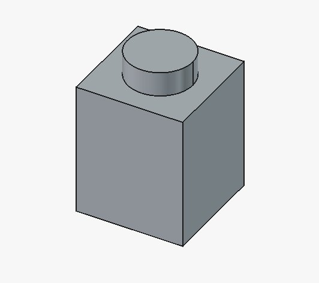
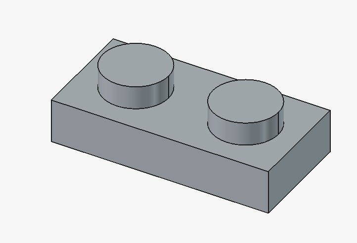
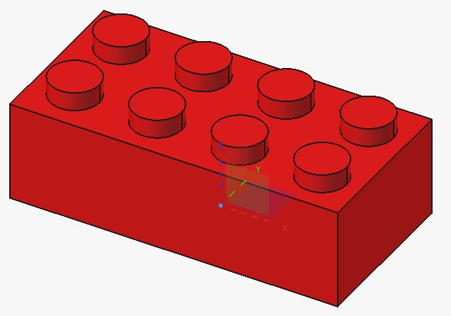
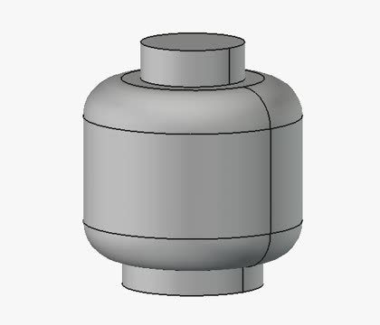
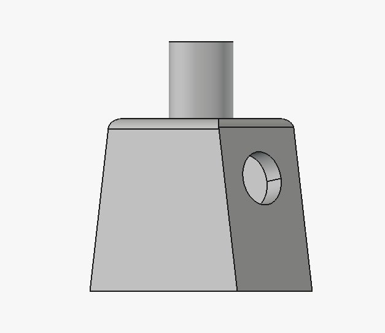

# FreeCAD: завдання та відеоуроки

Тут зібрані уроки з 3D-моделювання у **FreeCAD**. Ми почнемо з простих деталей LEGO, а потім крок за кроком змоделюємо цілого LEGO-чоловічка.

> **Потрібен FreeCAD версії 1.0 або новішої.**
>
> 💻 Завантажити безкоштовно: [freecad.org](https://www.freecad.org/downloads.php)
>
> 🌐 Онлайн-версія без встановлення: [FreeCAD Online](https://thecadhub.com/free-tools/freecad-web/). Працює лише в Chrome або Edge на комп'ютері. Це бета-версія, тож частина функцій може не працювати. Збережену модель завантажуйте собі як файл `.FCStd`.

## Як працювати з уроком

1. Подивіться відео до кінця.
2. Повторіть усі кроки у своєму FreeCAD. Відео можна ставити на паузу.
3. Збережіть файл з назвою, як написано в завданні.
4. Натисніть **«Позначити як виконане»** внизу сторінки уроку.
5. Надішліть файл `.FCStd` з роботою в **Google Classroom**.

## Деталі LEGO

  <a href="01-block-1x1.html">
    
    <b>Урок 1</b> Блок 1×1
  </a>
  <a href="02-plate-1x2.html">
    
    <b>Урок 2</b> Пластинка 1×2
  </a>
  <a href="03-block-2x4.html">
    
    <b>Урок 3</b> Блок 2×4
  </a>

## Проєкт: LEGO-чоловічок

Моделюємо фігурку окремими етапами.

  <a href="04-minifig-head.html">
    
    <b>Етап 1</b> Голова
  </a>
  <a href="05-minifig-torso.html">
    
    <b>Етап 2</b> Тулуб
  </a>

